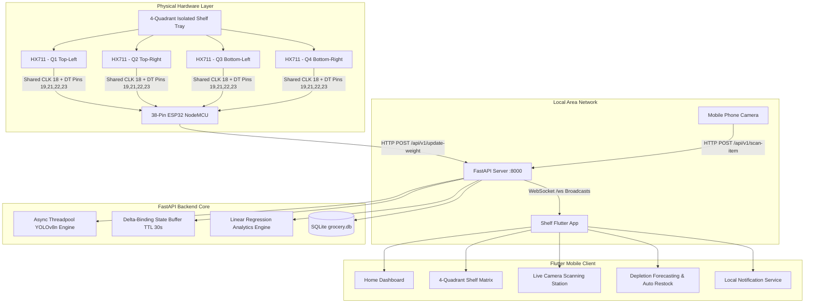
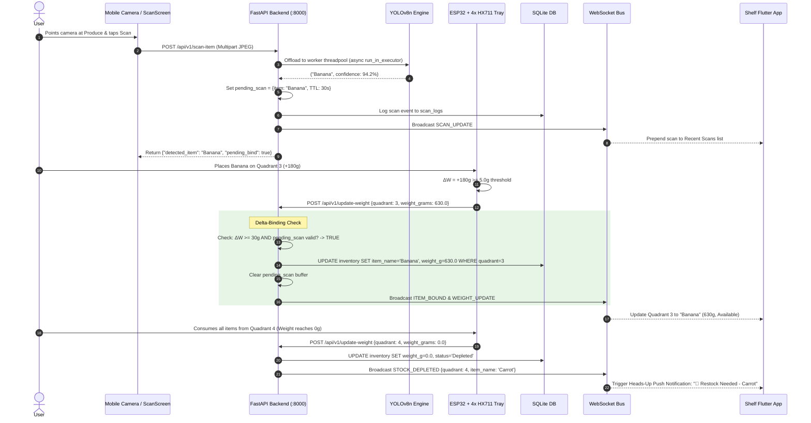

# Shelf AI-IoT Smart Shelf System — Master Project Document

> **Document Version:** 2.0.0  
> **Status:** Production / Reference Architecture & Development Master  
> **Last Updated:** September 2026  
> **Project Root:** `E:\SHELF`  
> **Target Audience:** Developers, Hardware Engineers, ML Engineers, System Architects

---

## Table of Contents
1. [Executive Summary & System Vision](#1-executive-summary--system-vision)
2. [End-to-End System Architecture](#2-end-to-end-system-architecture)
3. [Hardware & Firmware Layer (ESP32 + HX711)](#3-hardware--firmware-layer-esp32--hx711)
4. [Machine Learning & Computer Vision Pipeline](#4-machine-learning--computer-vision-pipeline)
5. [The Dynamic Delta-Binding Subsystem](#5-the-dynamic-delta-binding-subsystem)
6. [Backend Service & Data Layer (FastAPI + SQLite)](#6-backend-service--data-layer-fastapi--sqlite)
7. [Mobile Application (Flutter / Dart)](#7-mobile-application-flutter--dart)
8. [Chronological Change Log & Historical Bug Fixes](#8-chronological-change-log--historical-bug-fixes)
9. [Verification, Testing & Test Suites](#9-verification-testing--test-suites)
10. [Setup, Execution & Deployment Runbook](#10-setup-execution--deployment-runbook)
11. [Strategic Roadmap & Improvement Plan](#11-strategic-roadmap--improvement-plan)
12. [Complete Repository File Matrix](#12-complete-repository-file-matrix)

---

## 1. Executive Summary & System Vision

**Shelf** is an AI-IoT hybrid smart shelf infrastructure designed to eliminate manual inventory management in households, commercial kitchens, and retail environments. 

### Core Value Proposition
- **Automated Produce Recognition:** Eliminates manual item selection using YOLOv8 object detection.
- **Continuous Weight Telemetry:** High-precision 4-quadrant load cell matrix measuring real-time stock levels.
- **Dynamic Delta-Binding:** Intelligently pairs optical scans with tray placement events using weight delta ($\Delta W$) heuristics and TTL buffering.
- **Predictive Consumption Analytics:** Calculates linear regression slopes ($\Delta W / \Delta t$) across time-series weight logs to predict runout dates and automatically build grocery shopping lists.
- **Real-Time Synchronized UI & Notifications:** WebSocket-driven Flutter mobile app with Android high-priority heads-up push notifications for stock depletion.

---

## 2. End-to-End System Architecture

Shelf integrates physical hardware, high-throughput edge communications, an asynchronous REST/WebSocket server, and a cross-platform mobile client.



### System Interaction Lifecycle



---

## 3. Hardware & Firmware Layer (ESP32 + HX711)

### 3.1 Hardware Components
- **Microcontroller:** ESP32 Development Board (38-pin NodeMCU).
- **Weight Sensors:** 4x Strain Gauge Load Cells (rated for 1kg – 5kg capacity).
- **ADC Amplifiers:** 4x HX711 24-bit Analog-to-Digital Converter modules.
- **Physical Structure:** 4-quadrant tray platform with **2 mm physical air gaps** separating all quadrants to eliminate mechanical cross-talk and weight bleeding.

### 3.2 Pin Mapping Table
All 4 HX711 modules share a single Clock (`SCK`) line to preserve GPIO resources on the ESP32.

| Quadrant | Physical Tray Position | Clock Pin (Shared) | Data Pin (`DT`) | Operating Voltage |
| :--- | :--- | :--- | :--- | :--- |
| **Quadrant 1** | Top-Left | `GPIO 18` | `GPIO 19` | 3.3V / 5V |
| **Quadrant 2** | Top-Right | `GPIO 18` | `GPIO 21` | 3.3V / 5V |
| **Quadrant 3** | Bottom-Left | `GPIO 18` | `GPIO 22` | 3.3V / 5V |
| **Quadrant 4** | Bottom-Right | `GPIO 18` | `GPIO 23` | 3.3V / 5V |

### 3.3 Firmware Design Principles (`WeightScale_4Quad.ino`)
1. **Shared-Clock Bus Initialization:** Iterates through `DT_PINS[4]` with `CLK_PIN = 18`, setting gain to 128 (Channel A).
2. **Interactive Calibration & Tare:** At startup, prompts user over Serial (115200 baud) to ensure empty trays, executing `scales[i].tare(10)` to zero out tare offsets.
3. **Internal Scale Factor Application:** Utilizes `scales[i].set_scale(CALIBRATION_FACTORS[i])` such that calls to `scales[i].get_units(AVERAGES)` return weight directly in grams.
4. **Delta-Driven Event Reporting:**
   - Samples sensors every 500 ms (`READ_INTERVAL_MS`).
   - Maintains an moving average over 5 samples (`AVERAGES = 5`).
   - Only triggers an HTTP POST request if $|\Delta W| \ge 5.0\text{ g}$ or every 20 cycles (~10 seconds) for heartbeat telemetry.
   - Non-blocking 3-second HTTP timeout prevents network latency from freezing local sensor reads.
5. **Auto-Recovery:** Automatic Wi-Fi reconnection routines if the LAN link drops.

### 3.4 Calibration Formula
$$\text{Calibration Factor} = \frac{\text{Known Calibration Weight (grams)}}{\text{Raw ADC Reading} - \text{Tare Offset}}$$

```cpp
// Calibration factors inside esp32_weight_scale/WeightScale_4Quad.ino
float CALIBRATION_FACTORS[4] = {
  0.000418,   // Quadrant 1
  0.000418,   // Quadrant 2
  0.000418,   // Quadrant 3
  0.000418    // Quadrant 4
};
```

---

## 4. Machine Learning & Computer Vision Pipeline

### 4.1 Evolution of the Vision Engine
1. **Phase 1 (Synthetic CNN / Color Heuristic):** A custom 3-layer CNN trained on synthetic colored patches (`create_apple_model.py`). Faced severe color-space overlapping between red apples and orange-brown carrots.
2. **Phase 2 (MobileNetV2):** Evaluated transfer learning for classification; lacked spatial bounding and multiple-object resilience.
3. **Phase 3 (YOLOv8 Nano - Production):** Switched to **YOLOv8n** (`yolov8n.pt`, ~6.5 MB) pretrained on the COCO dataset. Features real-time inference, high generalization across lighting variations, and robust produce class detection.

### 4.2 Class Mapping & Confidence Filtering
COCO classes are mapped directly into Shelf produce classes:

```python
COCO_TO_PRODUCE = {
    "apple":    "Apple",
    "banana":   "Banana",
    "orange":   "Orange",
    "carrot":   "Carrot",
    "broccoli": "Broccoli",
}
CONF_THRESHOLD = 0.35
```

### 4.3 Async Inference Architecture
Ultralytics YOLO inference is CPU-heavy and blocking. To prevent blocking the FastAPI `asyncio` event loop (which handles WebSocket pings and telemetry), inference is isolated using thread pools:

```python
def _run_yolo_sync(image: Image.Image):
    model = get_yolo()
    if model is None:
        return "No Produce Detected", 0.0
    img_array = np.array(image)
    results = model(img_array, conf=CONF_THRESHOLD, verbose=False)
    
    best_label, best_conf = "No Produce Detected", 0.0
    for result in results:
        for box in result.boxes:
            coco_name = result.names[int(box.cls)].lower()
            if coco_name in COCO_TO_PRODUCE:
                conf = float(box.conf)
                if conf > best_conf:
                    best_conf = conf
                    best_label = COCO_TO_PRODUCE[coco_name]
    return best_label, round(best_conf * 100, 2)

async def run_yolo(image: Image.Image):
    loop = asyncio.get_event_loop()
    return await loop.run_in_executor(None, _run_yolo_sync, image)
```

---

## 5. The Dynamic Delta-Binding Subsystem

### 5.1 The Binding Problem
How does a smart shelf know *which* quadrant an item was placed on if the camera is positioned at an external scanning station or mobile phone?

### 5.2 Two-Phase Delta-Binding Mechanism
Shelf solves this through **temporal correlation between optical recognition and localized load cell delta events**:

```
[Camera Scan] ──> Sets pending_scan buffer (TTL = 30s)
                       │
                       ▼
[Placement]   ──> ESP32 senses weight increase on Quadrant Q_i
                       │
                       ▼
[Evaluation]  ──> If ΔW >= +30.0g AND pending_scan is valid:
                    ├─ Assign pending_scan.item to Quadrant Q_i
                    ├─ Clear pending_scan buffer
                    └─ Broadcast ITEM_BOUND + WEIGHT_UPDATE via WebSocket
```

### 5.3 Weight Threshold Matrix
- **Item Placement ($\Delta W \ge +30.0\text{ g}$):** Triggers auto-binding if `pending_scan` exists. If no scan exists, updates weight while retaining previous item label.
- **Consumption ($\Delta W \le -10.0\text{ g}$):** Records consumption, updates inventory weight, and logs to `weight_logs`.
- **Sensor Jitter ($ -10\text{ g} < \Delta W < +30\text{ g}$):** Filtered out to avoid erroneous bindings and excessive database writes.
- **Buffer Invalidation:** `pending_scan` automatically invalidates after 30 seconds (`PENDING_SCAN_TTL_SECONDS = 30`).

---

## 6. Backend Service & Data Layer (FastAPI + SQLite)

### 6.1 Database Schema (`grocery.db`)

#### Table: `inventory`
Tracks the current state of each of the 4 shelf quadrants.
```sql
CREATE TABLE inventory (
    id INTEGER PRIMARY KEY AUTOINCREMENT,
    quadrant INTEGER UNIQUE NOT NULL,      -- 1, 2, 3, or 4
    item_name TEXT NOT NULL,              -- e.g. "Apple", "Banana"
    weight_g REAL NOT NULL,               -- Current weight in grams
    max_capacity_g REAL DEFAULT 1000.0,   -- Tray max limit (default 1000g)
    status TEXT DEFAULT 'Available',      -- 'Available' | 'Low Stock' | 'Critical' | 'Depleted'
    last_updated TEXT                     -- Timestamp string (e.g. "10:30 PM")
);
```

#### Table: `weight_logs`
Chronological time-series log of all weight updates.
```sql
CREATE TABLE weight_logs (
    id INTEGER PRIMARY KEY AUTOINCREMENT,
    quadrant INTEGER NOT NULL,
    weight_g REAL NOT NULL,
    timestamp DATETIME DEFAULT CURRENT_TIMESTAMP
);
```

#### Table: `scan_logs`
Historical log of visual scan detections.
```sql
CREATE TABLE scan_logs (
    id INTEGER PRIMARY KEY AUTOINCREMENT,
    label TEXT NOT NULL,
    confidence REAL NOT NULL,
    timestamp DATETIME DEFAULT CURRENT_TIMESTAMP
);
```

### 6.2 Stock Status Thresholds
$$\text{Status} = \begin{cases} 
\text{"Depleted"} & \text{if } W = 0 \\
\text{"Critical"} & \text{if } 0 < W < 100\text{ g} \\
\text{"Low Stock"} & \text{if } 100\text{ g} \le W < 250\text{ g} \\
\text{"Available"} & \text{if } W \ge 250\text{ g}
\end{cases}$$

### 6.3 Linear Regression Depletion Forecasting
For each quadrant, the backend retrieves the last 20 records from `weight_logs`. If $\ge 3$ records exist, it computes an Ordinary Least Squares (OLS) linear regression:

$$\text{Weight}(t) = \text{Slope} \times t + \text{Intercept}$$

- **Time ($t$):** Converted to seconds since Unix epoch.
- **Depletion Rate ($\text{Rate}_{\text{daily}}$):** 
  $$\text{Rate}_{\text{daily}} = -\text{Slope} \times 86400 \quad (\text{g/day})$$
- **Estimated Days Remaining:**
  $$\text{Days Remaining} = \frac{\text{Current Weight (g)}}{\text{Rate}_{\text{daily}}}$$
- **Fallback Rates (Cold-Start):**
  - Apple: 120.0 g/day
  - Banana: 150.0 g/day
  - Orange: 140.0 g/day
  - Carrot: 100.0 g/day

### 6.4 API Route Catalog

| Method | Route | Description | Request Body / Params | Response Format |
| :--- | :--- | :--- | :--- | :--- |
| `GET` | `/` | API Root & Status | None | `{ status, system, version, vision, endpoints }` |
| `GET` | `/health` | Server & YOLO Readiness | None | `{ status, yolo_ready, yolo_available }` |
| `WS` | `/ws` | Real-time WebSocket Stream | Ping string | JSON Stream (`SCAN_UPDATE`, `WEIGHT_UPDATE`, etc.) |
| `GET` | `/api/v1/inventory` | List all 4 Quadrants | None | `[ { quadrant, item_name, weight_g, status, ... } ]` |
| `GET` | `/api/v1/inventory/summary` | Aggregate inventory counts | None | `{ total_items, critical, low_stock }` |
| `GET` | `/api/v1/scans` | Recent optical scan logs | Query `limit` (default 10) | `[ { id, label, confidence, timestamp } ]` |
| `GET` | `/api/v1/depletion-analytics` | Linear regression metrics | None | `[ { item_name, quadrant, current_weight_g, daily_rate_g, estimated_days_remaining, stock_status } ]` |
| `GET` | `/api/v1/pending-scan` | Status of pending bind buffer | None | `{ pending, item, confidence, age_seconds, expires_in }` |
| `POST` | `/api/v1/update-weight` | ESP32 telemetry & binding | `{ quadrant: int, weight_grams: float }` | `{ status, quadrant, updated_weight_g, delta_g, stock_status, item_name, bound_item? }` |
| `POST` | `/api/v1/scan-item` | Optical produce recognition | Multipart Form `file` (Image) | `{ success, detected_item, confidence, pending_bind }` |
| `POST` | `/api/v1/simulate-scan` | Mock scan for test/demo | `{ label: string, confidence: float }` | `{ status, detected_item, confidence }` |

---

## 7. Mobile Application (Flutter / Dart)

### 7.1 Architecture & Design System
- **Framework:** Flutter 3.x (Dart SDK `^3.12.2`)
- **Aesthetic System:** Modern organic green palette, clean card elevations, glassmorphic container accents.
  - **Forest Emerald (`#1B4D3E`):** Primary brand accent
  - **Mint Leaf (`#2EC4B6`):** Secondary accent / Available status
  - **Accent Orange (`#FF9F1C`):** Low Stock Warning
  - **Accent Red (`#E53935`):** Critical Alert & Depleted heads-up

### 7.2 Screen Breakdown
1. **HomeScreen (`lib/screens/home_screen.dart`):**
   - High-level metric summary (Total Items, Total Weight in kg).
   - "Quick AI Scan" CTA.
   - Depletion alert tiles showing days remaining.
   - Live Recent Scans feed updated reactively via WebSocket.
2. **InventoryScreen (`lib/screens/inventory_screen.dart`):**
   - 2x2 grid representing the 4 physical shelf quadrants.
   - Dynamic weight progress bars ($W / \text{MaxCapacity}$).
   - Color-coded badges (`Available`, `Low Stock`, `Critical`, `Depleted`).
3. **ScanScreen (`lib/screens/scan_screen.dart`):**
   - Live full-bleed camera preview using `camera: ^0.11.0+2`.
   - Custom reticle corner indicators for produce framing.
   - One-tap image capture and multipart upload to `/api/v1/scan-item`.
   - Visual banner displaying detection outcome and confidence percentage.
4. **AnalyticsScreen (`lib/screens/analytics_screen.dart`):**
   - Linear regression consumption velocity cards ($\Delta W / \Delta t$).
   - Projected days of supply.
   - Automated Grocery Restock Shopping List (auto-adds items with $\le 2.0$ days remaining).

### 7.3 Frontend Services & Networking
- **`ApiService` (`lib/services/api_service.dart`):**
  - Dynamically routes between `http://10.0.2.2:8000` (Android Emulator), `http://10.65.157.91:8000` (Physical Device on LAN), and `http://127.0.0.1:8000` (Desktop/Web).
  - Encapsulates error handling with `ApiResult<T>` containing `isOnline` flags.
- **`WsService` (`lib/services/ws_service.dart`):**
  - Resilient WebSocket connection to `/ws`.
  - Automatic reconnection logic with a 3-second backoff timer.
  - Broadcasts decoded event streams across the widget tree.
- **`NotificationService` (`lib/services/notification_service.dart`):**
  - Initializes Android notification channels (`shelf_stock_alerts`).
  - High-priority heads-up push notifications on `STOCK_DEPLETED` events.
  - Informational notifications on `Low Stock` / `Critical` transitions.

---

## 8. Chronological Change Log & Historical Bug Fixes

### 8.1 Major Milestones
- `544721f` — Initial repository commit.
- `bc0d17f` — Initial FastAPI and SQLite schema implementation.
- `68bbba2` — Flutter client UI foundation and bottom navigation.
- `6315f7f` — Linear regression depletion analytics implemented in database layer.
- `71217dd` — Integration of custom CNN classifier model for produce recognition.
- `0048a7b` — WebSocket event bus service added to Flutter frontend.
- `3da5d6b` — 4-Quadrant HX711 ESP32 firmware release (`WeightScale_4Quad.ino`).
- `b18edd5` — Transitioned vision engine from MobileNetV2/Custom CNN to YOLOv8n.
- `ea341ae` — Implemented 30-second TTL `pending_scan` buffer for Dynamic Delta-Binding.
- `322924e` — Rewrote ESP32 firmware with shared-clock wiring (GPIO 18) for all 4 load cells.
- `b097790` — Multi-bug resolution and smoke test suite integration.

### 8.2 Critical Bugs Identified & Resolved

#### Bug 1: YOLO Inference Freezing the Async Event Loop
- **Symptom:** During an optical scan, all background WebSocket heartbeats and ESP32 weight updates hung for 1–3 seconds on CPU.
- **Root Cause:** Synchronous execution of `model.predict()` inside the async `scan_item` route blocked the single Python `asyncio` event loop.
- **Fix:** Split into `_run_yolo_sync()` and `run_yolo()`, offloading inference to Python's background thread pool via `await asyncio.get_event_loop().run_in_executor(None, _run_yolo_sync, image)`.

#### Bug 2: Missing `await` on Async Model Call
- **Symptom:** Unhandled exception: `TypeError: cannot unpack non-iterable coroutine object`.
- **Root Cause:** Calling `run_yolo(image)` without the `await` keyword returned a coroutine instead of `(label, confidence)`.
- **Fix:** Added `await run_yolo(image)` in `backend/main.py`.

#### Bug 3: Double Calibration Factor Applied in ESP32 Firmware
- **Symptom:** ESP32 reported astronomical or erratic weights over HTTP.
- **Root Cause:** The firmware called `scales[i].set_scale(FACTOR)` in `setup()`, but then divided the reading by `0.000418` again in the `loop()` read block.
- **Fix:** Retained `scales[i].set_scale(CALIBRATION_FACTORS[i])` during initialization and called `scales[i].get_units(AVERAGES)` directly without redundant mathematical operations.

#### Bug 4: Apple vs. Carrot Color Overlap in Synthetic Dataset
- **Symptom:** Red apples consistently misclassified as carrots.
- **Root Cause:** Synthetic data generator had overlapping RGB bounds for red and orange.
- **Fix:** Retrained with strictly partitioned RGB distributions (Apple: Red $\ge 0.7$, Green $\le 0.2$, Blue $\le 0.15$; Carrot: Red $0.5-0.8$, Green $0.2-0.4$, Blue $\le 0.15$) before migrating to YOLOv8.

#### Bug 5: Android Gradle Plugin (AGP) and Camera Plugin Compatibility
- **Symptom:** Gradle build failure: `checkDebugAarMetadata failed — androidx.camera requires AGP >= 8.9.1`.
- **Root Cause:** Version mismatch between Gradle Wrapper, AGP, and Flutter's camera dependency.
- **Fix:** Pinned `camera: ^0.11.0+2` in `pubspec.yaml`, upgraded Gradle wrapper to `8.11.1`, and aligned `settings.gradle.kts`.

---

## 9. Verification, Testing & Test Suites

### 9.1 Smoke Test Suite (`backend/smoke_test.py`)
A 36-assertion automated integration test executed against a live backend instance:
1. `GET /health` — Verifies HTTP 200, YOLO readiness, and library availability.
2. `GET /` — Confirms version `2.0.0` and route listings.
3. `GET /api/v1/inventory` — Confirms all 4 quadrants returned.
4. `GET /api/v1/inventory/summary` — Verifies count aggregations.
5. `GET /api/v1/depletion-analytics` — Validates linear regression payload structure.
6. `GET /api/v1/pending-scan` — Verifies initial empty buffer state.
7. `POST /api/v1/update-weight` — Validates consumption and delta calculations.
8. `POST /api/v1/update-weight` (invalid quadrant 5) — Confirms HTTP 400 rejection.
9. `POST /api/v1/simulate-scan` — Verifies mock scan logging and WebSocket dispatch.
10. `GET /api/v1/scans` — Validates scan log retrieval.
11. `POST /api/v1/scan-item` — Submits synthetic test JPEG and verifies YOLO execution.
12. `Delta-Binding End-to-End` — Tests sequence of optical detection followed by weight placement.

### 9.2 Real Produce Binding Test (`backend/test_binding.py`)
Validates delta-binding using real high-resolution banana photos from `dataset/Banana/`:
- Step 1: Capture baseline weight on Quadrant 3.
- Step 2: Post banana photograph to `/api/v1/scan-item` (verifies YOLO confidence > 80%).
- Step 3: Assert `pending_scan` contains `"Banana"` with active TTL.
- Step 4: Post weight update ($\Delta W = +180.0\text{ g}$) to Quadrant 3.
- Step 5: Assert response contains `"binding": "auto"` and `"bound_item": "Banana"`.
- Step 6: Verify `inventory` table reflects updated item name and `pending_scan` is cleared.

---

## 10. Setup, Execution & Deployment Runbook

### 10.1 Backend Setup (FastAPI)
```bash
# 1. Navigate to backend
cd E:\SHELF\backend

# 2. Activate virtual environment
..\.venv\Scripts\activate

# 3. Install requirements
pip install fastapi uvicorn pillow ultralytics numpy

# 4. Start the server
uvicorn main:app --reload --host 0.0.0.0 --port 8000
```
- API Docs: `http://127.0.0.1:8000/docs`
- Health Check: `http://127.0.0.1:8000/health`

### 10.2 Hardware Setup (ESP32)
1. Open Arduino IDE.
2. Install libraries via Library Manager:
   - `HX711` by Bogdan Necula
   - `ArduinoJson` (v6 or v7)
3. Open `esp32_weight_scale/WeightScale_4Quad.ino`.
4. Configure constants:
   ```cpp
   const char* WIFI_SSID     = "Your_WiFi_SSID";
   const char* WIFI_PASSWORD = "Your_WiFi_Password";
   const char* SERVER_IP     = "10.65.157.91"; // Your PC's LAN IP
   ```
5. Connect ESP32 via USB and flash at 115200 baud.
6. Open Serial Monitor, clear trays when prompted, and send any character to complete tare.

### 10.3 Mobile App Setup (Flutter)
```bash
# 1. Navigate to Flutter project
cd E:\SHELF\shelf_app

# 2. Fetch packages
flutter pub get

# 3. Run on Android Emulator
flutter run

# 4. Run on Physical Android Device (Ensure PC & Phone on same Wi-Fi)
# Verify serverIp in lib/services/api_service.dart matches PC's LAN IP
flutter run -d <device_id>

# 5. Run on Chrome Web / Windows Desktop
flutter run -d chrome
flutter run -d windows
```

---

## 11. Strategic Roadmap & Improvement Plan

### 11.1 Short-Term Enhancements (Sprint 1–2)
- [ ] **Multi-Item Recognition:** Upgrade YOLO parsing to handle multiple bounding boxes simultaneously and support multi-item tray placements.
- [ ] **Configurable Quadrant Capacity:** Allow users to customize `max_capacity_g` per quadrant via the Flutter UI.
- [ ] **Historical Analytics Charts:** Implement interactive line graphs using `fl_chart` in Flutter for 7-day and 30-day weight trends.
- [ ] **Automated Re-Tare Trigger:** Add a `/api/v1/tare` API endpoint to tare load cells remotely from the mobile app.

### 11.2 Medium-Term Enhancements (Sprint 3–4)
- [ ] **Embedded Edge AI:** Mount an ESP32-CAM module directly above the shelf to automatically trigger scans upon detecting optical motion.
- [ ] **Temperature & Humidity Tracking:** Integrate DHT22 sensors to correlate shelf climate with produce spoilage rates.
- [ ] **Cloud Backend Migration:** Deploy FastAPI and PostgreSQL to AWS/GCP (Cloud Run / RDS) with MQTT telemetry for multi-shelf support.
- [ ] **Barcode & RFID Hybrid Scanning:** Add barcode fallback for packaged groceries that lack distinct visual features.

### 11.3 Long-Term Vision (Enterprise & Commercial)
- [ ] **Automated E-Commerce Restocking:** Direct integration with grocery delivery APIs (Instacart, Blinkit, Amazon Fresh) to auto-order groceries when supply drops below 1.5 days.
- [ ] **Predictive Machine Learning (LSTM / Prophet):** Replace linear regression with time-series forecasting models accounting for day-of-week consumption patterns and seasonal trends.
- [ ] **Multi-Tenant Smart Pantry:** Role-based access control (RBAC) for shared kitchens, restaurant pantries, and office snack bars.

---

## 12. Complete Repository File Matrix

```
E:\SHELF\
├── backend\
│   ├── dataset\                       # Produce sample image datasets (Banana, etc.)
│   ├── models\                        # Legacy and neural network weight archives
│   ├── database.py                    # SQLite connection, CRUD, seed data & linear regression
│   ├── find_detectable_banana.py      # Utility script for YOLO confidence verification
│   ├── grocery.db                     # Active SQLite database file
│   ├── main.py                        # FastAPI application, YOLO pipeline, WebSocket, delta-binding
│   ├── smoke_test.py                  # Comprehensive 36-check backend integration test suite
│   ├── test_binding.py                # End-to-end delta-binding verification script
│   ├── test_scan_endpoint.py          # Dedicated scan-item HTTP test script
│   ├── test_yolo_scan.py              # YOLO inference accuracy testing script
│   └── yolov8n.pt                     # YOLOv8 Nano PyTorch model weights (COCO pretrained)
│
├── esp32_weight_scale\
│   ├── Shelf_WeightScale_Test.ino   # Initial load cell hardware verification sketch
│   ├── LoadCell_Calibration.ino       # Baseline single-cell calibration sketch
│   ├── LoadCell_Calibration_Fixed/    # Isolated calibration routine with hardcoded pins
│   ├── LoadCell_Calibration_V2/       # Interactive live ADC count monitor sketch
│   ├── SimpleTest.ino                 # Sanity test for HX711 communication
│   ├── SingleLoadCell_Test/           # Single-cell testing sketch
│   └── WeightScale_4Quad.ino          # Production 4-quadrant shared-clock telemetry firmware
│
├── shelf_app\
│   ├── android\                       # Android native project files, Gradle scripts & manifests
│   ├── ios\                           # iOS native project files & Runner configuration
│   ├── lib\
│   │   ├── constants\                 # Application constants
│   │   ├── models\
│   │   │   ├── depletion_metric.dart  # Data model for consumption velocity & days left
│   │   │   ├── grocery_item.dart      # Data model for quadrant inventory item state
│   │   │   └── scan_log.dart          # Data model for visual scan history records
│   │   ├── navigation\
│   │   │   └── bottom_navigation.dart # 4-tab bottom navigation scaffold controller
│   │   ├── screens\
│   │   │   ├── analytics_screen.dart  # Consumption velocity & auto grocery list UI
│   │   │   ├── home_screen.dart       # Main dashboard, summary cards, live recent scans
│   │   │   ├── inventory_screen.dart  # 4-quadrant visual shelf matrix UI
│   │   │   └── scan_screen.dart       # Camera viewfinder & optical recognition station UI
│   │   ├── services\
│   │   │   ├── api_service.dart       # HTTP REST client with auto-IP routing
│   │   │   ├── notification_service.dart # Local push notification manager (Android channels)
│   │   │   └── ws_service.dart        # Reconnecting WebSocket listener singleton
│   │   ├── theme\
│   │   │   └── app_theme.dart         # Brand palette, typography, card & button styles
│   │   ├── widgets\
│   │   │   ├── camera_card.dart       # Camera preview card widget
│   │   │   ├── detection_card.dart    # Visual scan result display card widget
│   │   │   ├── offline_banner.dart    # Graceful offline connectivity warning banner
│   │   │   └── weight_card.dart       # Quadrant weight telemetry widget
│   │   └── main.dart                  # Flutter application entry point
│   └── pubspec.yaml                   # Flutter dependency specifications & asset mappings
│
├── FINAL_SOLUTION.md                  # Detailed resolution report for Apple/Carrot misclassification
├── SHELF_MASTER_DOCUMENT.md         # Master System Reference & Architectural Blueprint (This Document)
├── IMPLEMENTATION_SUMMARY.md          # Historical feature implementation log
├── README.md                          # Quickstart guide & project overview
├── test_api.py                        # Root level API test script
├── test_fix.py                        # Verification script for produce recognition
└── VERIFICATION_SUMMARY.md            # Validation results and test summaries
```

---
*End of Master Document — Shelf AI-IoT Smart Shelf System*
